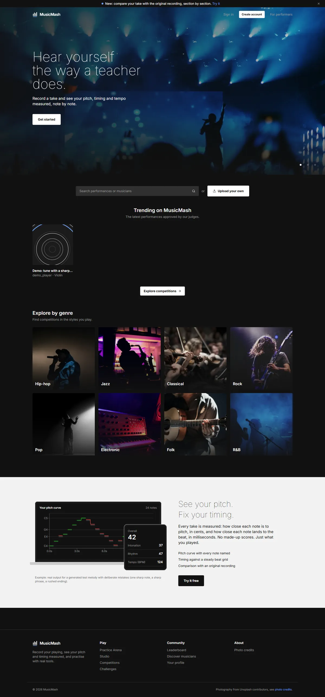
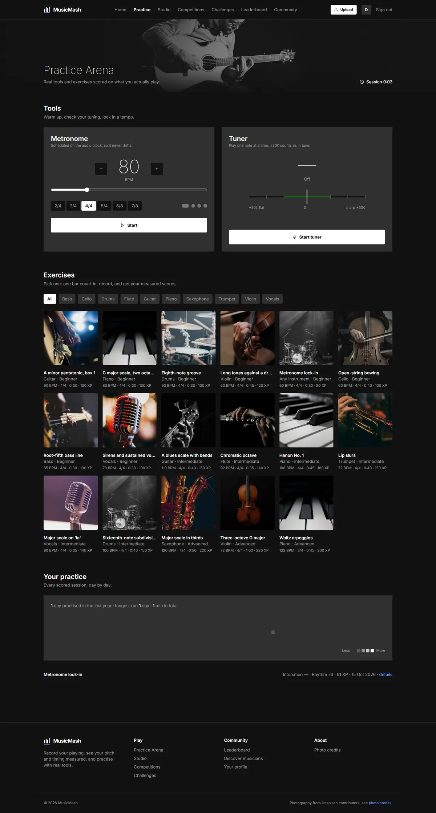
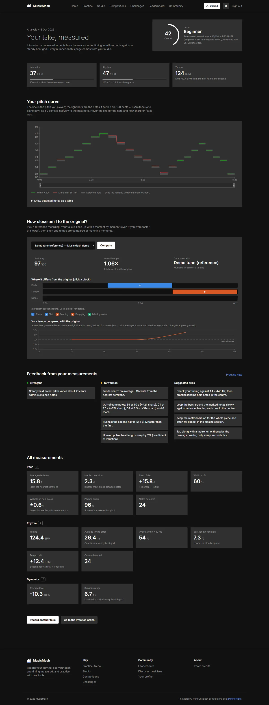
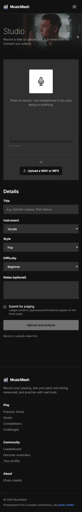

# Music Mash - Platform Architecture

## Overview

Music Mash is a scalable platform for music skill development, connecting musicians with expert judges and AI-powered feedback systems. The platform provides an accessible way for talented musicians to showcase their skills, receive professional feedback, and compete in a supportive community.

## Project Status

**Implementation Status: Complete (All 11 Phases)**

✅ **Phase 1:** Database + Authentication - MySQL integration, JWT auth, user registration/login  
✅ **Phase 2:** User Profiles + Dashboard - Onboarding flow, profile management, real-time dashboard  
✅ **Phase 3:** Performance Studio + Recording - Audio/video recording, file upload, draft management  
✅ **Phase 4:** Judge Evaluation - Performance evaluation, scoring system, feedback generation  
✅ **Phase 5:** Competitions + Leaderboard - Competition system, leaderboard, registration  
✅ **Phase 6:** Practice Arena + Gamification - Guided exercises, XP system, level progression  
✅ **Phase 7:** AI Analysis + AI Coach - AI-powered performance analysis and coaching  
✅ **Phase 8:** Challenges + Achievements - Challenge system, achievement tracking, rewards  
✅ **Phase 9:** Social + Discovery + Notifications - User discovery, social features, notifications  
✅ **Phase 10:** Premium UI/UX + Animations - Enhanced navigation, mobile responsiveness, animations  
✅ **Phase 11:** Testing + Optimization + Documentation - Build verification, documentation updates

## Project Vision

Help talented musicians who cannot afford expensive music courses by providing:
- Performance showcase platform
- Expert judge evaluations
- AI-powered feedback
- Skill progression tracking
- Competition system
- Community growth

## Architecture Documentation

### 1. [System Architecture](ARCHITECTURE.md)
Complete system architecture including:
- High-level architecture diagram
- Microservices breakdown
- Technology stack details
- Security architecture
- Data flow architecture
- Scalability strategy
- Monitoring & observability
- Deployment architecture

### 2. [Database Design](DATABASE_DESIGN.md)
Database schema including:
- Entity relationship diagram
- Table definitions
- Relationships between entities
- Indexes and constraints

### 3. [Database Schema](DATABASE_SCHEMA.sql)
Complete SQL schema for MySQL:
- All table definitions
- Foreign key constraints
- Indexes
- Ready to execute

### 4. [Backend Structure](BACKEND_STRUCTURE.md)
Backend folder structure:
- Microservices organization
- Package structure per service
- Common components
- Docker configuration

### 5. [API Design](API_DESIGN.md)
REST API endpoints for all services:
- Authentication Service (Port 8081)
- User Service (Port 8082)
- Performance Service (Port 8083)
- Evaluation Service (Port 8084)
- Competition Service (Port 8085)
- Notification Service (Port 8086)
- WebSocket endpoints

### 6. [Development Roadmap](DEVELOPMENT_ROADMAP.md)
32-week development plan:
- Phase 1: Foundation & Authentication (Weeks 1-4)
- Phase 2: Performance & Evaluation (Weeks 5-8)
- Phase 3: Competition System (Weeks 9-12)
- Phase 4: AI Service Foundation (Weeks 13-16)
- Phase 5: Advanced AI Features (Weeks 17-20)
- Phase 6: Additional AI Features (Weeks 21-24)
- Phase 7: Testing & Optimization (Weeks 25-28)
- Phase 8: Deployment & Launch (Weeks 29-32)
- Phase 9: Post-Launch (Ongoing)

### 7. [AI Integration Strategy](AI_INTEGRATION.md)
AI service implementation:
- AI service architecture
- Feature implementation details
- Technology stack
- Integration flow
- API endpoints
- Model training strategy

## Technology Stack

### Backend
- Java 17+ with Spring Boot 3.x
- Spring Security 6.x with JWT
- Hibernate/JPA with MySQL 8.0+
- Maven for dependency management

### Frontend
- React 18+
- Tailwind CSS 3.x
- React Router 6.x
- Framer Motion for animations
- Axios for API calls
- React Hot Toast for notifications

### Database
- MySQL 8.0+ for primary data storage
- Schema includes: users, profiles, performances, evaluations, competitions, challenges, achievements, notifications

### Infrastructure
- File upload service for audio/video storage
- Environment variable configuration for security
- Production-ready build system (Vite)

## Backend Services

The backend is currently implemented as a monolithic Spring Boot application with the following modules:

1. **Authentication** - User auth, JWT tokens, registration/login
2. **User Management** - Profiles, onboarding, user data
3. **Performance** - Upload, storage, metadata, draft management
4. **Evaluation** - Judge evaluations, scoring system
5. **Competition** - Competitions, leaderboard, registration
6. **Practice** - Exercises, XP system, gamification
7. **Challenges** - Challenge system, achievements, rewards
8. **Social** - User discovery, follow system, notifications
9. **File Upload** - Audio/video file storage service

**Note:** The architecture is designed to be easily split into microservices as the application scales.

## Frontend Features

### Pages & Routes
- **Landing Page** - Public landing with project overview
- **Authentication** - Login and registration with JWT
- **Onboarding** - Multi-step user profile setup
- **Dashboard** - User stats, recent performances, activity feed
- **Profile** - Profile management and editing
- **Upload** - Audio/video recording and file upload
- **Practice Arena** - Guided exercises with XP rewards
- **Challenges** - Challenge system and achievements
- **Social** - User discovery, follow system, notifications
- **Competitions** - Competition browsing and registration
- **Leaderboard** - Global rankings display
- **AI Analysis** - Performance analysis results
- **Judge Dashboard** - Performance evaluation interface

### UI/UX Features
- Dark "concert darkroom" design: flat, quiet interface; photography and cover art carry the colour
  (tokens and components in [docs/MUSICMASH_DESIGN_SYSTEM.md](docs/MUSICMASH_DESIGN_SYSTEM.md))
- Responsive design (mobile, tablet, desktop), visible keyboard focus, reduced-motion support
- Smooth animations with Framer Motion
- Toast notifications
- Loading states and skeletons
- Empty states
- Form validation
- Protected routes with authentication
- Active navigation highlighting
- Dropdown menus
- Mobile hamburger menu

## Screenshots

| Landing | Practice Arena |
|---|---|
|  |  |
| **AI Analysis** | **Studio (phone)** |
|  |  |

Every page at 1440 px and 390 px: run `scripts/ui_screenshots.py` (see [RUN_LOCAL.md](RUN_LOCAL.md));
output goes to `screenshots/ui/`. Photos are from Unsplash, credited in
[music-mash-frontend/public/images/CREDITS.md](music-mash-frontend/public/images/CREDITS.md).

## Getting Started

### Prerequisites
- Java 17+
- Node.js 18+
- MySQL 8.0+
- Maven (for backend)
- npm/yarn (for frontend)

### Local Development Setup

#### 1. Database Setup
```bash
# Start MySQL or use existing instance
# Run the database schema
mysql -u root -p < DATABASE_SCHEMA.sql
```

#### 2. Backend Setup

The backend reads its secrets from environment variables (see `music-mash-backend/.env.example`).
`application.properties` only contains `${DB_USERNAME}`, `${DB_PASSWORD}` and `${JWT_SECRET}` placeholders,
so the app will fail to start until these are set.

| Variable | Meaning |
|---|---|
| `DB_USERNAME` | MySQL user (e.g. `root`) |
| `DB_PASSWORD` | MySQL password |
| `JWT_SECRET` | Base64-encoded key, at least 32 bytes when decoded |

**PowerShell (current terminal session only):**
```powershell
$env:DB_USERNAME = "root"
$env:DB_PASSWORD = "your-mysql-password"
$env:JWT_SECRET  = [Convert]::ToBase64String((1..48 | ForEach-Object { Get-Random -Maximum 256 }))
cd music-mash-backend
mvn spring-boot:run
# Backend runs on http://localhost:8081
```
To keep them across sessions use `[Environment]::SetEnvironmentVariable("DB_PASSWORD", "...", "User")`
and open a new terminal. Keep the same `JWT_SECRET` between runs, otherwise existing tokens stop working.

**Git Bash:** `export DB_USERNAME=root DB_PASSWORD=... JWT_SECRET=$(openssl rand -base64 48)`

**IntelliJ IDEA:** Run → Edit Configurations → select the Spring Boot app → *Environment variables* →
`DB_USERNAME=root;DB_PASSWORD=...;JWT_SECRET=...`

**VS Code (Spring Boot / Java extension):** add an `env` block to the launch configuration in
`.vscode/launch.json`, or point `envFile` at a local, git-ignored `.env` file:
```json
{
  "type": "java",
  "name": "MusicMash Backend",
  "request": "launch",
  "mainClass": "com.musicmash.MusicMashApplication",
  "projectName": "music-mash-backend",
  "envFile": "${workspaceFolder}/music-mash-backend/.env"
}
```
(`.env` files are git-ignored; only `.env.example` is committed.)

#### 3. Frontend Setup
```bash
cd music-mash-frontend
cp .env.example .env   # sets VITE_API_URL
npm install
npm run dev
# Frontend runs on http://localhost:3000
```

#### 4. Build for Production
```bash
cd music-mash-frontend
npm run build
# Output in dist/ directory
```

## Development Phases

Follow the [Development Roadmap](DEVELOPMENT_ROADMAP.md) for phased implementation:
- Start with authentication and user management
- Build performance upload and evaluation
- Implement competition system
- Add AI capabilities
- Test and optimize
- Deploy to production

## API Documentation

API endpoints are documented in [API Design](API_DESIGN.md). Once implemented, Swagger UI will be available at:
- http://localhost:8081/swagger-ui.html (Auth Service)
- http://localhost:8082/swagger-ui.html (User Service)
- etc.

## Security

- JWT-based authentication
- Role-based access control (USER, JUDGE, HOST, ADMIN)
- BCrypt password encryption
- HTTPS/TLS encryption
- Rate limiting
- Input validation
- SQL injection prevention

## AI Features

Everything the AI service shows is measured; see
[music-mash-ai/docs/METRICS.md](music-mash-ai/docs/METRICS.md).

- **Measured pitch and rhythm**: intonation in cents (pYIN), timing error in ms against a
  fitted beat grid, tempo and tempo drift, note-by-note pitch curve
- **Reference comparison**: a take aligned with an original recording (DTW), with problem
  sections such as "sharp", "rushing" or "missing notes"
  ([ALIGNMENT.md](music-mash-ai/docs/ALIGNMENT.md))
- **AI coach**: measured problems → matching exercises from a practice library → optional
  LLM advice that may only quote measured numbers, plus a 7-day plan
  ([AI_COACH.md](music-mash-ai/docs/AI_COACH.md)). Without an API key it runs in a labelled
  "basic mode" with no generated text.

### About Chroma (used by the AI coach)

[Chroma](https://www.trychroma.com/) is a small vector database that runs inside the Python
AI service and keeps its data in a folder (`music-mash-ai/chroma_db/`, gitignored); there is no
server to install. Each practice doc is turned into an embedding (a list of 384 numbers that
captures its meaning, from the local `all-MiniLM-L6-v2` model via sentence-transformers) and
stored with metadata such as its problem tags and instruments. The coach asks Chroma for the
docs whose embeddings are closest to a problem description, filtered by that metadata.
Rebuild it after editing `music-mash-ai/knowledge/*.md`:

```powershell
cd music-mash-ai
.venv\Scripts\python scripts\build_knowledge_index.py
```

## Monitoring

- Prometheus for metrics collection
- Grafana for visualization
- ELK Stack for logging
- Health checks for all services
- Error tracking and alerting

## Contributing

Follow clean architecture principles:
- SOLID principles
- DTO pattern
- Exception handling
- Input validation
- Unit tests (80%+ coverage)
- Code review required

## License

Proprietary - All rights reserved

## Contact

For questions about the architecture, refer to the individual documentation files or contact the development team.
