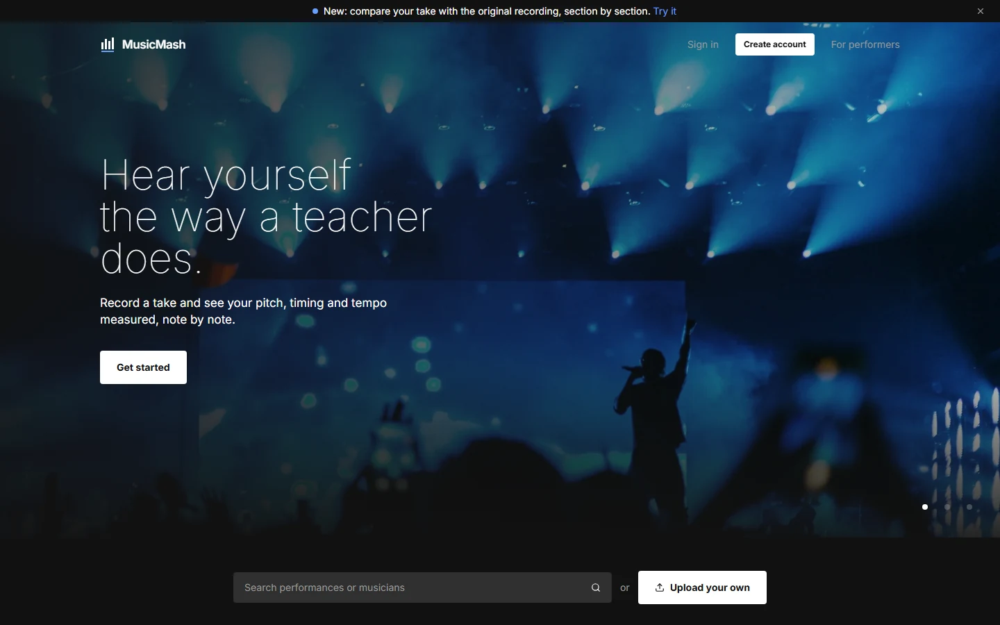
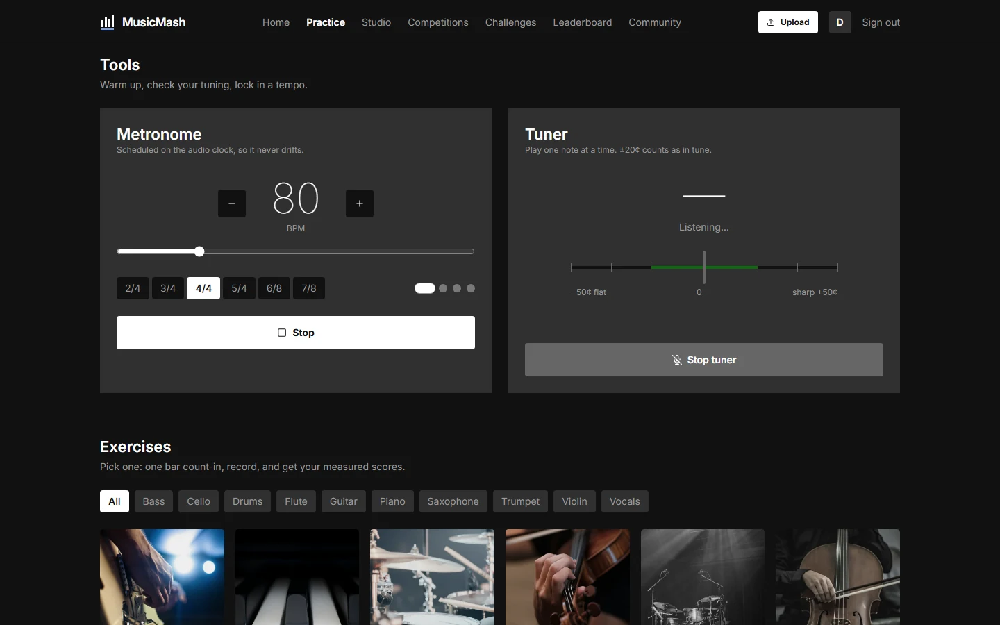
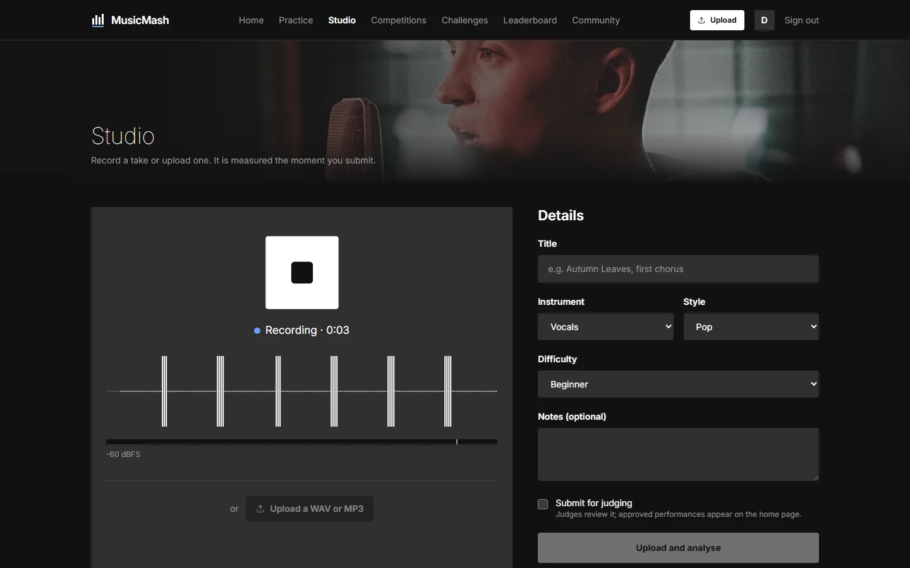
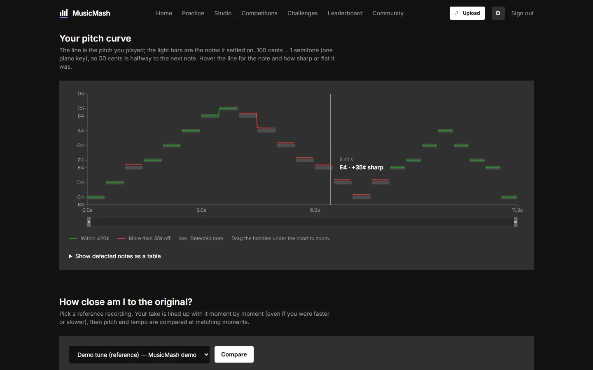
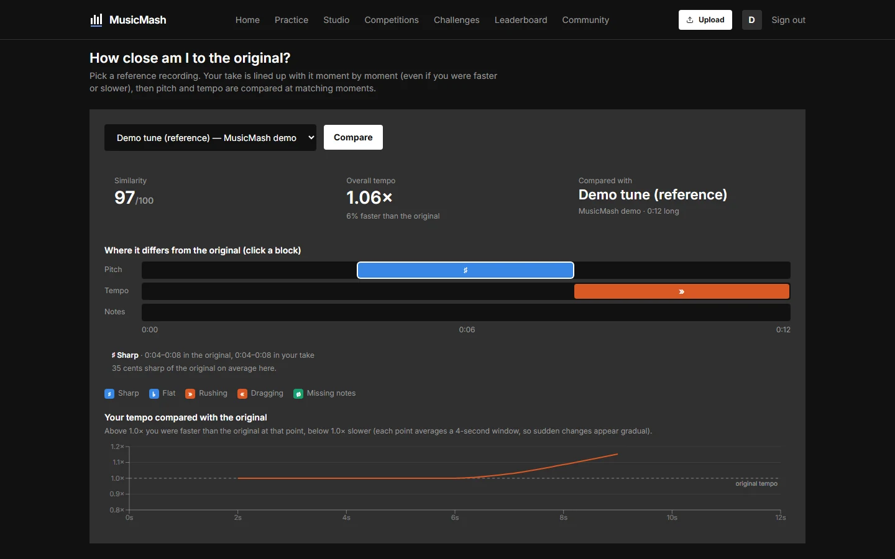
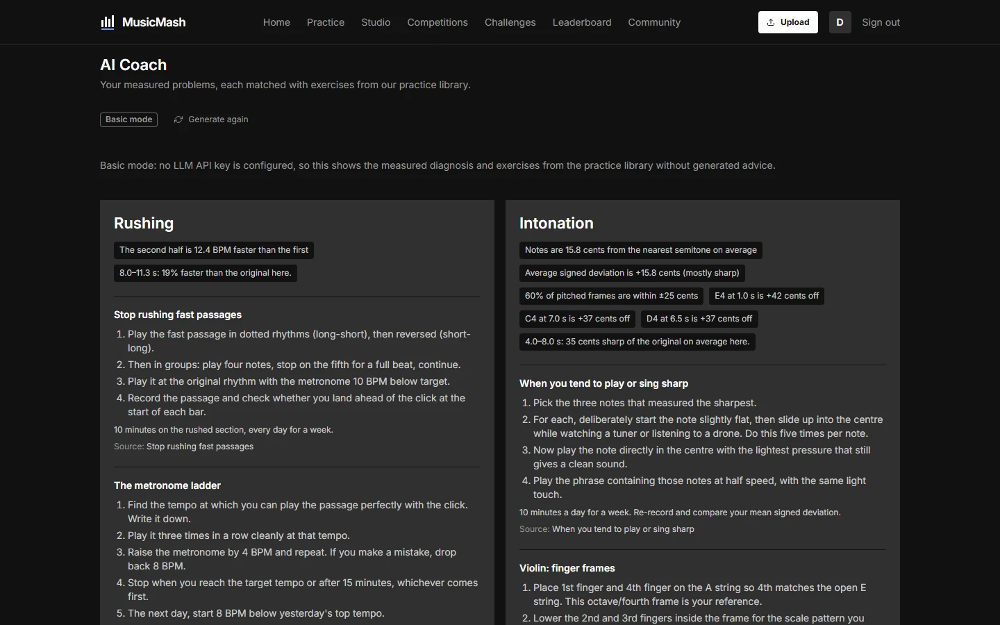
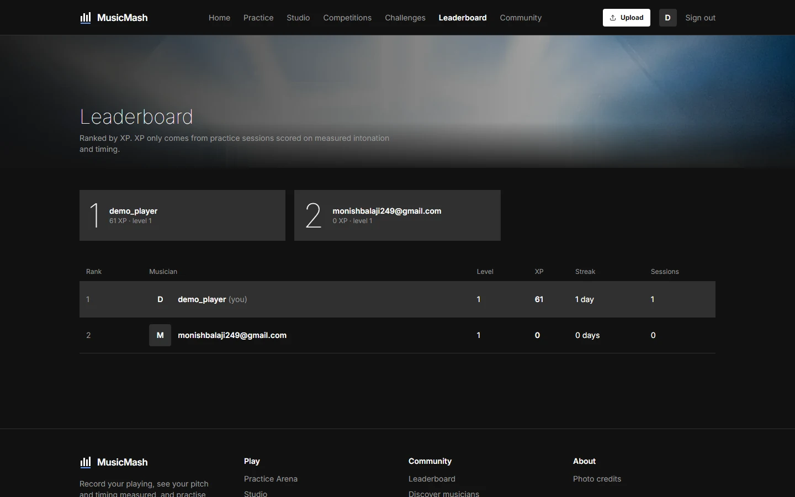
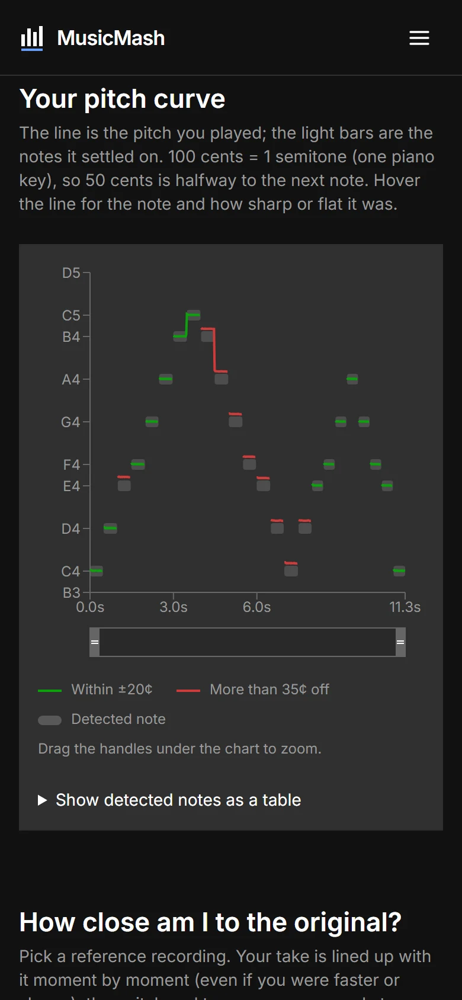
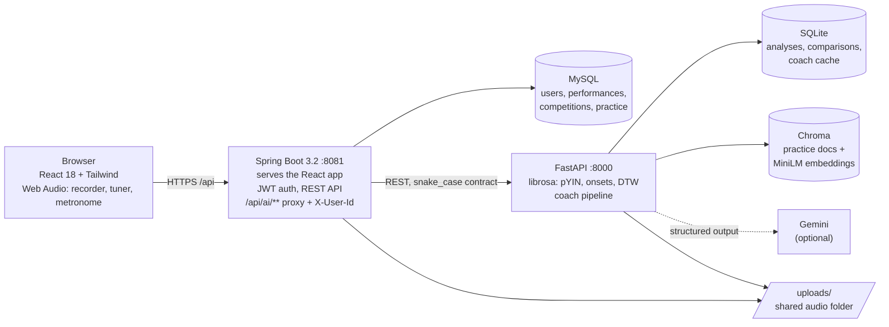

# MusicMash

**An AI music-practice platform that measures your pitch in cents and your timing in milliseconds,
then coaches you using only what it measured.**

[](https://github.com/Codewithmonish/musicmash/actions/workflows/ci.yml)
[](LICENSE)


**[▶ Watch the full demo](docs/media/demo.mp4)** (2 minutes, MP4). The GIF above is the same walkthrough at 3× speed.

Record or upload a take and MusicMash tells you, note by note, how far from the centre of the
pitch you were and how far from the beat you landed. It can line your take up with an original
recording to show where you rushed or went sharp, and an AI coach turns those measurements into a
practice plan. Every number on screen is computed from your audio; when something can't be
measured, the app says so and explains why.

## Screenshots

| | |
|---|---|
|  |  |
| **Landing.** Photography carries the colour; the interface stays flat and quiet. | **Practice Arena.** Lookahead-scheduled metronome and an in-browser YIN tuner with ±20/35 ¢ bands. |
|  |  |
| **Studio.** Record in the browser with a live level meter and waveform, or upload a WAV/MP3. | **Pitch curve.** Every note coloured by how far off it was; hovering shows the note and its cents. |
|  |  |
| **Reference comparison.** DTW lines the take up with the original; blocks mark where it went sharp or rushed. | **AI coach.** Measured problems as evidence chips, exercises from the practice library, a 7-day plan. |
|  |  |
| **Leaderboard.** Ranked by XP, which only comes from sessions scored on measured intonation and timing. | **Mobile.** Every page works at 390 px. |

## Features

**Platform**
- Accounts with JWT authentication, onboarding (instruments, styles, level) and profiles
- Performances: record or upload, then analyse; submit for judging
- Competitions with registration, hosted by HOST users
- Human judging on six criteria with written feedback; approved performances appear on the home page
- Leaderboard, follow other musicians, notifications
- AI results are private: another user's analysis, comparison or coaching returns 404
- One-click Windows launcher: React served by Spring on one address, `http://localhost:8081`

**AI & audio**
- Intonation in cents per note with pYIN, plus a note-by-note pitch curve
- Timing error in milliseconds against a fitted beat grid, tempo and tempo drift
- Comparison with an original recording using dynamic time warping, with sharp / flat /
  rushing / dragging / missing-notes sections
- RAG practice coach with a grounding check, plus a "basic mode" that needs no API key
- Rule-based level and feedback from those measurements (a trained model is Phase 6)

**Practice tools**
- Metronome scheduled on the Web Audio clock (40–220 BPM, time signatures, accented downbeat)
- Live tuner (YIN in plain JavaScript) with a cents needle
- Exercise library; each session records, gets analysed, and earns XP from the measured result
- Practice heatmap of the last year, session clock and streaks

## How the AI works

- **Intonation (pYIN, cents).** librosa's pYIN estimates the pitch of every frame. Each frame is
  compared with the nearest equal-tempered note: `cents = 100 · (midi − round(midi))`, where
  `midi = 69 + 12·log2(f0/440)`. That gives a range of ±50 ¢, with + meaning sharp. Notes are segmented from stable
  stretches, and the app reports mean deviation, sharp/flat bias and steadiness within held
  notes. → [METRICS.md](music-mash-ai/docs/METRICS.md)
- **Rhythm (onsets vs a beat grid).** Onsets are detected from the onset-strength envelope and a
  steady grid is fitted to the tracked beats at sixteenth-note resolution. Timing error is the mean
  |onset − nearest grid point| in ms; tempo drift is second-half minus first-half BPM.
  → [METRICS.md §4](music-mash-ai/docs/METRICS.md)
- **Reference comparison (DTW).** Both recordings become sequences of chroma, onset and pitch
  features. Dynamic time warping finds the cheapest alignment path, so a slower or faster take
  still lines up note for note. Along the path the app compares pitch (cents) and local tempo
  and flags problem sections. → [ALIGNMENT.md](music-mash-ai/docs/ALIGNMENT.md)
- **RAG coach with a grounding check.** Plain code first turns the metrics into a diagnosis
  whose evidence quotes the measured values ("Average signed deviation is +15.8 cents"). Chroma
  then retrieves practice docs for each problem, filtered by instrument and level. An LLM (Gemini via
  LangChain, structured output) writes the advice. Code then checks it: evidence must be quoted
  verbatim, sources must be retrieved docs, and any number that wasn't measured gets the answer
  rejected. Without an API key, the coach shows the diagnosis and exercises as written.
  → [AI_COACH.md](music-mash-ai/docs/AI_COACH.md)

## Architecture



| Layer | Technology |
|---|---|
| Frontend | React 18, Vite, Tailwind CSS, Framer Motion, Recharts, Web Audio API |
| Backend | Spring Boot 3.2 (Java 17), Spring Security + JWT, Spring Data JPA, MySQL |
| AI service | FastAPI, librosa (pYIN, onsets, chroma), NumPy/SciPy, SQLAlchemy + SQLite |
| AI coach | LangChain, Gemini (`langchain-google-genai`), Chroma, sentence-transformers (all-MiniLM-L6-v2) |
| Testing | pytest (generated audio), JUnit 5, shared JSON contract fixtures, Playwright checks |
| Tooling | GitHub Actions CI, PowerShell launcher, Pillow and ffmpeg for media |

## Quick start (Windows)

**One click.** Double-click `MusicMash.bat` (or the Desktop shortcut from
`scripts\create_shortcut.ps1`). The first run sets everything up. Later runs start in about 35 s
and open `http://localhost:8081`. Press any key in the window, or close it, to stop.

**Needs:** Java 17+, Maven, Node.js 18+, Python 3.11+ and a running MySQL. The launcher handles
the rest: venv, packages, frontend build, jar build, health checks.

**Environment variables** (names only; copy each `.env.example` to `.env`):

| Service | Required | Optional |
|---|---|---|
| `music-mash-backend/.env` | `DB_USERNAME`, `DB_PASSWORD`, `JWT_SECRET` | |
| `music-mash-ai/.env` | | `LLM_PROVIDER`, `LLM_API_KEY`, `LLM_MODEL` (coach falls back to basic mode) |
| `music-mash-frontend/.env` | | `VITE_API_URL` (developer mode only) |

**Manual / developer mode** (Vite hot reload on 5173, demo data, Playwright screenshots):
see [RUN_LOCAL.md](RUN_LOCAL.md).

## Project structure

```
musicMash/
├── MusicMash.bat            one-click launcher (runs scripts/launch.ps1)
├── music-mash-frontend/     React app
│   ├── src/                 pages, components (ui, ai, practice), audio (Web Audio)
│   └── public/images/       Unsplash photos + CREDITS.md
├── music-mash-backend/      Spring Boot API
│   ├── src/main/java/       controllers, services, entities, security
│   └── src/test/java/       JUnit tests
├── music-mash-ai/           FastAPI AI service
│   ├── app/                 api, services/audio (pure DSP), services/coach, models, schemas
│   ├── knowledge/           36 practice docs for the coach
│   ├── tests/               pytest suite, all audio generated in code
│   └── docs/                METRICS, ALIGNMENT, AI_COACH
├── contracts/               JSON fixtures shared by Spring and FastAPI tests
├── scripts/                 launcher, build, demo data, screenshots, media
├── docs/                    design system, screenshots, media, archive
└── .github/workflows/       CI
```

## Testing

| Suite | Command | Count |
|---|---|---|
| AI service | `cd music-mash-ai; .venv\Scripts\python -m pytest` | 119 tests (+1 slow test needing the real embedding model: `-m slow`) |
| Backend | `cd music-mash-backend; mvn test` | 15 tests (contract, serialisation, practice scoring) |
| Frontend | `cd music-mash-frontend; npm run build` | build must pass |

Test audio is generated in code. For example, a 440 Hz sine detuned by +30 ¢ must measure about
+30 ¢, and clicks at 120 BPM with ±40 ms jitter must give the expected timing error. CI runs all
three on every push and pull request.

## Roadmap

- **Phase 5:** instrument auto-detection (a classifier trained on a public dataset, with a report)
- **Phase 6:** a trained skill-level model to replace the current rule-based thresholds
- **Phase 7:** integration, clean-up and deployment (containers, hosted demo)

## Credits

- **Photos:** 62 photographs from [Unsplash](https://unsplash.com), used under the Unsplash
  License. Every photographer is credited in
  [CREDITS.md](music-mash-frontend/public/images/CREDITS.md) and on the in-app Photo credits page.
- **Melodies:** every melody in the tests and the demo is a note sequence generated in code for
  this project. No recordings or third-party melodies are included.
- **Typeface:** Inter (SIL Open Font License).

## License

[MIT](LICENSE) © 2026 Codewithmonish. Photos keep the Unsplash License and the typeface its
own licence, as listed in [LICENSE](LICENSE).

## Author

**Codewithmonish** · [github.com/Codewithmonish](https://github.com/Codewithmonish)
