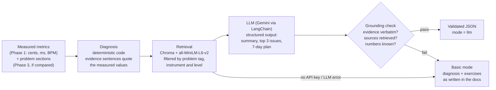

# AI coach (Phase 4)

The coach turns one analysis into practice advice: what to fix first, which exercise to use,
and a 7-day plan. It is built so that **every number it shows was measured** and every
exercise comes from our own practice library.

Code: `app/services/coach/diagnosis.py`, `app/services/coach/knowledge.py`,
`app/services/coach_service.py`, `app/api/coach.py`. Tests: `tests/test_coach.py`.

## Pipeline



1. **Diagnosis** (`diagnose()`, pure). Each metric is compared with the same thresholds the
   analysis page uses for strengths and weaknesses (`skill_prediction_service.py`), for example
   mean |deviation| > 20 cents, |mean signed deviation| > 10 cents (then "mostly sharp/flat"),
   |tempo drift| > 3 BPM (rushing/dragging), mean timing error > 30 ms. Each problem gets
   evidence sentences that quote the stored values, e.g.
   `Average signed deviation is +31.0 cents (mostly sharp)` or
   `The second half is 6.2 BPM faster than the first`. Problem sections from a reference
   comparison are added as evidence (`8.0–11.0 s: 25% faster than the original here.`).
   Problems are sorted by how far past their threshold they are; the top 3 are coached.
2. **Retrieval** (`KnowledgeBase.retrieve()`). 36 short practice docs in `knowledge/`, each with
   front-matter `problem_tags`, `instruments`, `level`. They are embedded once by
   `scripts/build_knowledge_index.py` into a local Chroma database. For each problem we search
   only docs with that problem tag, for "any" instrument or the user's instrument, and not above
   the user's level. The best instrument-specific doc always gets a slot.
3. **LLM** (optional). The prompt contains only the evidence sentences and the retrieved docs,
   and tells the model to copy evidence verbatim, cite a source id for every exercise and write
   no numbers except those it was given. LangChain's `with_structured_output(LLMCoachOutput)`
   makes Gemini return JSON that Pydantic validates (at most 3 issues, exactly 7 days).
4. **Grounding check** (`grounding_problems()`). Even a well-instructed model can paraphrase or
   invent, so the answer is checked in code:
   - every `evidence` line must be *exactly* one of the diagnosis sentences;
   - every `source_doc` must be one of the retrieved docs;
   - every number anywhere in the generated text must appear in the evidence or the retrieved
     docs (plus day numbers 1–7).

   If any check fails, the generated text is thrown away and the response falls back to basic
   mode, with a note saying why.
5. **Basic mode** is used when there is no `LLM_API_KEY`, the LLM call fails, or the check fails.
   It shows the diagnosis and the retrieved exercises exactly as the docs write them, plus a
   fixed 7-day rotation over those exercises. Nothing in it is generated text, and the UI labels
   it "Basic mode".

Results are cached per analysis in the `coach_reports` table. `refresh: true` regenerates; a
cached basic-mode result is regenerated automatically once an API key is configured.

## Why grounding prevents hallucinated advice

An LLM asked "how can this violinist improve?" will happily answer with plausible numbers
("you're about 15 cents flat") and generic exercises it can't justify. Here:

- **The facts are computed before the LLM sees anything.** The diagnosis is ordinary,
  tested code, so "mostly sharp" is true because `mean_signed_cents > 10`, not because a
  model guessed.
- **The model only gets what it may use.** No raw audio, no user history, just evidence
  sentences and a handful of retrieved docs. Retrieval is filtered by problem tag, so a
  timing problem can only pull timing exercises.
- **The output is checked, not trusted.** The evidence must match character for character,
  sources must be retrieved ids, and unknown numbers cause rejection. A hallucinated "52 cents"
  can't reach the user (`test_grounding_rejects_invented_evidence_numbers_and_sources`).
- **There's an honest fallback.** When the LLM is missing or fails the check, the user still
  gets real, measured advice, clearly labelled, instead of an error or fake text.

What the check can't catch: wording that misdescribes a quoted fact without using a new number
(e.g. calling a sharp tendency "flat"). The evidence chips shown next to each issue are the
measured truth, so the user can always see the source.

## API

`POST /api/ai/coach/{analysis_id}` (Spring: `POST /api/ai/coach/{analysisId}`, which adds the
user's experience level from their profile).

Request (all optional): `{"level": "BEGINNER", "instrument": "VIOLIN", "refresh": false}`

Response (`CoachResponse`): `mode` (`llm` | `basic`), `model`, `diagnosis[]` (key, tag, label,
evidence), `summary`, `top_issues[]` (issue, evidence, exercise, how_long, source_doc),
`plan[]` (day 1–7, focus, tasks), `exercises[]` (retrieved docs per diagnosis), `notes[]`.

## Setup

```powershell
cd music-mash-ai
.venv\Scripts\python scripts\build_knowledge_index.py   # after changing knowledge/*.md
```

The first run downloads the embedding model (about 90 MB, cached by Hugging Face). The index lives in
`chroma_db/` (gitignored) and is also built automatically on the first coach request.

To enable the LLM, set in `music-mash-ai/.env` (never commit it):

```
LLM_PROVIDER=google
LLM_API_KEY=<your Gemini API key>
LLM_MODEL=gemini-2.5-flash
```

**Chroma** is a small vector database that runs inside the Python process and stores its
data in a folder (no server to install). We store each doc's embedding (a 384-number vector
from `all-MiniLM-L6-v2` that captures its meaning) plus metadata flags (`tag_sharp`,
`inst_violin`, `level_rank`), then ask for the nearest vectors that match a metadata filter.

## Limitations

- Dynamics are not diagnosed: their metrics are descriptive only (METRICS.md §5), so there is no
  validated "too flat" threshold. Dynamics docs exist for later use.
- "Rushing/dragging" comes from tempo drift over the take and from reference comparisons. There
  is no signed "N ms early" metric, because the beat grid is fitted to the onsets, so the mean
  signed offset is about zero by construction.
- The knowledge base is 36 hand-written docs, so advice is only as good and as broad as they are.
- The grounding check ensures every fact is traceable to a measurement or a doc; it doesn't
  judge whether the advice is musically good.
