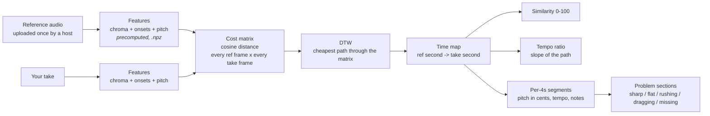
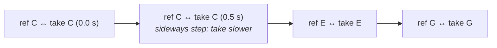

# Reference comparison with Dynamic Time Warping (DTW)

**Question it answers:** "How close is my take to the original recording, and *where* is it
different?"

Code: `app/services/audio/alignment.py` (pure functions), `app/services/comparison_service.py`
(background jobs), `app/api/comparison.py` (endpoints). Tests: `tests/test_alignment.py`.

---

## 1. Why we can't just compare second by second

If you play a piece slightly slower than the original, second 10 of your take is not
second 10 of the original. Compare them directly and every note after the first few
seconds looks "wrong", even if you played every note perfectly.

So before comparing anything, we need a **map between the two timelines**: "my 10.4 s
corresponds to the original's 9.8 s". Building that map is what DTW does.

> **Analogy.** Two people walk the same hiking trail, one faster and with a stop for
> photos. DTW pairs each point of one walk with the matching point of the other walk
> ("both at the bridge", "both at the summit"), however their speeds differed.

## 2. The pipeline



## 3. Step by step

### 3.1 Features: what "a moment of music" looks like to the computer

Every ~93 ms (`FEATURE_HOP` = 2048 samples at 22 050 Hz) we describe the sound with 13 numbers:

- **12 chroma values** (`librosa.feature.chroma_cqt`): how much energy is in each of the
  12 pitch classes C, C#, D … B, regardless of octave. A C major chord lights up C, E and G.
  Chroma ignores timbre, so a violin and a piano playing the same notes look alike.
- **1 onset-strength value** (weight 0.5): how much a new note is starting right now. This
  helps the alignment snap to note boundaries, e.g. when the same note repeats.

Each 13-number frame is scaled to length 1 (L2-normalised), so loudness doesn't matter.
A tiny constant is added first, so silence becomes a flat vector instead of zero, and
silence then matches silence.

### 3.2 The cost matrix

For every reference frame *i* and every take frame *j* we compute the **cosine distance**
between their feature vectors: 0 = identical, 1 = nothing in common.

With a reference of *N* frames and a take of *M* frames, that's an *N × M* grid. A 3-minute
pair is about 1 950 × 1 950 ≈ 3.8 million cells (30 MB).

### 3.3 DTW: the cheapest path

DTW finds a path from the top-left cell (both starts) to the bottom-right cell (both
ends). At each step it may move:

- **diagonally**: both recordings move forward together (same tempo)
- **down**: the reference moves on while the take holds (the take is slower here)
- **right**: the take moves on while the reference holds (the take is faster here)

Among all such paths, it picks the one whose cells add up to the **lowest total cost**.
Dynamic programming makes this cheap: each cell's best cost is its own cost plus the
cheapest of its three neighbours above/left, so one pass over the grid suffices.
This is `librosa.sequence.dtw`.

**Tiny worked example.** Reference notes `C E G`, take `C C E G` (the first note held
twice as long). Costs are 0 for the same note and 1 otherwise:

```
              take:   C    C    E    G
reference C   [0] -> [0]   1    1
reference E    1     1   [0]   1
reference G    1     1    1   [0]
```

The cheapest path, `(C,C) → (C,C) → (E,E) → (G,G)`, costs **0**. DTW has "explained" the
take as the reference with the first note stretched. That's exactly the warping we want.
Its sideways step at the start says "the take was slower there".



**Constraints we add**
- **Sakoe-Chiba band (`DTW_BAND` = 25%):** the path may not stray more than 25% from the
  diagonal. This stops absurd matches like "the whole first minute equals one second".
- **Open end when the reference was cut:** references are cut at 3 minutes. A take may be
  longer (up to 4.5 minutes, `MAX_PERFORMANCE_SECONDS`), so a slower take still contains the
  whole cut section. In that case we use *subsequence* DTW (`subseq=True`): the whole
  reference must match one stretch of the take, and the take's start and end are free.
  Forcing both ends to meet would squeeze different music together; that bug was caught by
  timing a 3-minute, 1.1×-faster take, which measured 1.0.

## 4. What we compute from the path

| Output | How | Unit |
|---|---|---|
| `similarity` | `100 × clip(1 − mean cost along the path ÷ mean cost of ALL cells, 0, 1)`. "How much better than pairing frames at random." Identical recordings → 100; no better than random → 0. Because the baseline comes from the same two recordings, the scale adapts to the instrument and timbre. | 0–100 |
| `played_similarity` | The same, using only path points where the take is sounding (within 40 dB of its loudest frame). Leaving out a passage lowers `similarity` but not this. | 0–100 |
| `tempo_ratio` | Aligned reference span ÷ aligned take span. 1.2 = you played 20% faster overall. | ratio |
| `tempo_curve` | Every 1 s: slope of a least-squares line through the path over a 4-second window, inverted (reference seconds per take second). | ratio |
| `segments` | The reference cut into 4-second windows. For each: the matching take span, the **median pitch difference in cents** (your f0 looked up at the aligned moment, `1200·log2(yours/original)`, folded to ±600 so an octave-lower part isn't "1200 cents flat"), local tempo, pitched-frame coverage and onset counts. | — |
| `problem_sections` | Rules per segment (below); consecutive segments with the same issue are merged. | — |

**Problem rules** (constants at the top of `alignment.py`)

| Issue | Rule |
|---|---|
| `pitch_sharp` / `pitch_flat` | median cents > +25 / < −25 (needs ≥ 30% of the segment pitched in both) |
| `rushing` / `dragging` | local tempo ratio > 1.10 / < 1/1.10 |
| `missing_notes` | the reference is pitched there but fewer than 50% of those moments have a pitch in your take, or you have fewer than half its note onsets |

**Reliability gate.** DTW *always* finds some path, even between two different pieces.
It warps to whatever matches best, so per-section feedback on a different piece would be
invented. If `played_similarity` < 60, `problem_sections` is empty, `reliable` is false
and `unreliable_reason` explains why. Similarity and the tempo curve are still shown.

## 5. Cost and limits

- **Time and memory are O(N × M)** in the number of frames. Measured at the limit
  (3-minute reference, 3-minute take, this dev machine):

  | Step | Time |
  |---|---|
  | Reference features (once, at upload) | ~24 s |
  | Take features (pitch tracking dominates) | ~56 s |
  | Cost matrix + DTW + comparison | **0.9 s**, ~90 MB peak |

  That's why pitch tracking uses a 46 ms hop for comparisons (half the work of the 23 ms
  hop) and the feature hop is 93 ms. Every step's time is written to the log.
- Jobs run in the background (`POST /compare`, then poll `/status`), like `/analyze`.

## 6. What it does NOT handle

- **A different key.** Chroma of a piece transposed up a tone doesn't match the original's,
  so a transposed performance scores low. Transposition-invariant matching (trying all 12
  chroma shifts) is a possible extension.
- **Arrangement and polyphony.** Chroma compares *which pitch classes sound*. A solo take
  against a full-band recording shares only part of its chroma, so similarity is lower and
  pitch (pYIN tracks one note) may follow the wrong part of the reference.
- **Repeats and skips.** DTW is monotonic. Repeating a bar, or jumping back, can't be
  represented; it shows up as rushing/dragging around the jump.
- **Smoothing.** Tempo uses 4-second windows, so a sudden change appears as a ramp, and
  segment rules can't flag problems shorter than about a segment.
- **Not musical judgement.** A deliberate rubato reads as "dragging". The tool reports
  differences from the reference, not mistakes.

## 7. Validation (generated audio, `tests/test_alignment.py`)

| Case | Result |
|---|---|
| Melody vs itself | similarity 100, no problems |
| Same melody 1.2× faster | similarity 96.8, tempo ratio 1.20 (curve 1.19–1.21), flagged `rushing` |
| Second half +50 cents | `pitch_sharp` exactly at 4–8 s, median +50 cents |
| First half −40 cents | `pitch_flat` exactly at 0–4 s |
| Second half silent | `missing_notes` from 4 s; still reliable |
| A different melody | similarity 42.6, unreliable, no invented sections |
| Reference cut at 4 s, 1.2× take | tempo 1.2 via open-end DTW |
| Live demo through Spring (`scripts/demo_seed.py`) | `pitch_sharp` 4–8 s (35 c, planted +35) and `rushing` 8–12 s (19%, planted 20%) |

## 8. Interview cheat sheet

- **What is DTW?** An algorithm that aligns two sequences that unfold at different speeds,
  by finding the cheapest monotonic path through their pairwise-distance matrix
  (dynamic programming).
- **Complexity?** O(N·M) time and memory. Mitigated with a coarse feature hop (93 ms), a
  3-minute cap and a Sakoe-Chiba band.
- **Why chroma?** It captures *which notes* sound and ignores timbre and octave, so
  different instruments and recordings of the same music look alike.
- **Why cosine distance?** It compares the *shape* of the pitch-class distribution, not
  its loudness.
- **How is tempo measured?** It's the slope of the warping path: one reference second
  mapped to 0.83 take seconds means 1.2× faster.
- **Why not cross-correlation?** That finds a single constant offset. DTW handles tempo
  that changes over time.
- **What can go wrong?** Different key, different arrangement, repeats, and DTW
  "succeeding" on a different piece. That last one is why there's a reliability gate.
